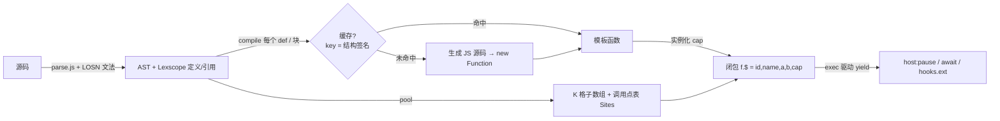

# goal-losn.md - LOSN Lisp:新语法 / 转译 walker / p5 重构 实施计划

状态:**已重新开始**： 废弃版本的代码耦合度过高，缺乏可复用的经验。

---

## 0. 已定的决策

| # | 决策 | 落点 |
|---|---|---|
| 1 | 另起 **LOSN Lisp**:独立文法 + 独立 walker,文件 `losn.js`,和 `extra.js` 同一种加载(整份就是一句 `(P) => ({ … })`,没有 IIFE / 全局) | §2.1 |
| 2 | 执行 = **函数转译成 JS(generator)并缓存**,不再逐节点 tree-walk;Lexscope 只管解析期的定义/引用,不进运行期 | §2.2-2.4 |
| 3 | 调试范围收窄为:**函数 CST、函数名断点、闭包序列化**。删除:逐节点事件(`in/out/if`)、范围断点、F10 语句 / F11 事件步进 | §2.6-2.7、§3 |
| 4 | Tweak 声明下标**始终不含接收者**;`u` 只是有作用域语义的普通参数 | §2.9 |
| 5 | 上轮 4 条建议全部采纳:颜色/字符串热替换、`{->}` 写入事件、`{->}` 目标快照 + 轨迹预览、调用头名字统一 | §2.5、§2.8-2.9 |
| 6 | 新特性:`def` 不再只是语法糖(`def Pair` + 之后小写 `def` 自动成方法,`def OK` 取消);`req ./x.losn` 导入 | §1.6-1.7 |
| 7 | **解析器不手写**:LOSN 全部语法用 `parse.js` 元语言文法(`rules`)表达,走 `P.grammar` / `P.eat`;元语言缺的能力在 `parse.js` 里补,不在 `losn.js` 里绕开 | §2.1 |
| 8 | `OK` 退出**函数** = `def` 与绑了名字的 lambda;`OK^` 退出**块** = `.{ }`、`?.{ }`、直接当实参的匿名 `[-] { }` | §1.2、§2.3 |

不变:键名内插、`w@`、`..` 管道、`xargs`、多项式 `2x`、颜色/路径字面量、ES6 模板字符串 call、`(tweak …)` 声明。**变了**:`OK` / `OK^` 改成编译期形式(§1.2、§2.3),不再是普通函数。

---

## 1. 语法

### 1.1 两种位置

| | 语句位置(行首 / `{}` 块内) | 参数位置(`( )` 内、`$( )` 内、`.{ }` 外的实参) |
|---|---|---|
| `[f a]` | **调用** | 列表 |
| `{k v}` | 更新 / 重赋值块(§1.3) | KV 对象 `{k v}`;`{- k v - k v}` 另一种写法 |
| `f a b` | 同一行并列即调用;换行结束语句 | 不适用,要写 `(f a b)` |
| 中缀 | 无 | 只在 `$( )` 里 |

`[-x]> …` 的 `[ ]` 不算语句位置(它是参数表)。`([-x]> x + 1) 0` 仍是并列调用。

### 1.2 形式一览

| 写法 | 含义 / 脱糖 |
|---|---|
| `- v e`,同一行可连写 `- v e - v1 e1` | 单赋值(不可变绑定),只能在语句位置,无括号无分号 |
| `{t e}` | 重赋值(局部,无则初始化),取代 `[-> t e]` |
| `{->o {k e} ->o2 {}}` | **对象赋值**:原地改 `o` 的字段并返回 `o`;块内 `it` = 该字段旧值;**不支持**单个 `"k" v`。`o` 是**引用**,不是定义(Lexscope 里不给它建定义,xref 指向 `o` 原来的定义) |
| `[-x-y]> e` / `[-]> e` | 单语句 lambda,体默认是 `$(中缀)` |
| `[-x-y] { … }` / `- f [-x-y] { … }` | 块 lambda / 命名;`tick [-] { … }` 是零参块 |
| `f.{ … }` | 把块追加成最后一个实参,**首参叫 `it`** |
| `x?.{ … }` | `(As x 块)`,**参数叫 `u`**;数组逐项处理并丢掉 NO,假值原样,否则调用 |
| `x..(f a)` | 管道:`(f x a)`;`..(f)`(零个额外实参)也可以,如 `"s"..(w@)` |
| `o.k` / `o.(k a)` / `o.[i]` | 取键 / **方法调用**(只调 `o` 自己的方法,不回退到作用域函数)/ 下标(= `o.(at_ [i])`,`at_` 是运算符覆盖用的方法) |
| `$(2x + 3y > 7)` | 唯一有中缀的地方;`2x` 多项式不变;`(>)` `(-)` 函数保持屏蔽。运算符只有三层:`* / %` > `+ -` > `< > <= >= == !=`,左结合;**故意没有** `&& \|\| **`(逻辑用 `both` / `is` / `?`)。层次用元语言文法写(`rules` 里的规则,和四则运算 TDOP/Chain 示例同一种写法) |
| `$(c)? A Or B` | if(`Or` 可在下一行行首对齐) |
| `is x` | `!!x`(返回布尔);`is c? A` 换行 `Or c2? B` 换行 `Or C` 是多行对齐的 else-if 链 |
| `OK v` | **总是退出所在函数**(`def`、绑了名字的 lambda),哪怕写在 `.{ }` 块里;返回 `v` |
| `[OK^ v]` | 退出**最近的块**(`.{ }` / `?.{ }` / 匿名 `[-] { }`),块的值 = `v`;在 `each` 里相当于结束本次迭代 |
| `` echo`a ${x}` `` / `` `a ${x}` `` | tag call / 模板字符串,不变 |
| `console.` 行尾的 `.` | 续行:下一行缩进的 `(log …)` 是它的方法调用(demo 第 89-90 行) |
| `imp.alert "wtf"` | 行首单方法 → `globalThis.(alert "wtf")`;`imp` 一直是 global 表(§1.4) |
| `req ./xx.losn` | 见 §1.7 |

### 1.3 `{}` 的三种读法

```
{t $(2x + 3y > 7)}                          # 语句位置、首项不是 ->:重赋值 t
{->user {"age" $(it + 1)} ->other {}}       # 语句位置、首项是 ->键:对键更新
- user {name "parviz" langs ["js" "lisp"]}  # 参数位置:KV 对象
```

`?` 的分支和 `$( )` 内都是参数位置,所以**分支里放不了 `{->…}`**;需要时拆成 `def`(demo 第 128-130 行的 `floor-hit`)。

`{v e}` 是普通的 mut 赋值:定义(首次)或重赋值局部 `v`;`{->o {…}}` 是对象赋值:改 `o` 指向的对象,`o` 本身不变。两者在 Lexscope 里的区别:前者产生定义,后者只产生引用。

### 1.4 名字解析(顺序)

1. 词法绑定(参数、`-`、`def`、`{t …}`)→ 模块级名字 → LOSN 内建(`len` `map` `at` `str` `neg` `both` `range` `wait` `OK` …)。
2. 都不是,且处在**带 `u` 参数**的作用域里(`?.{ }` 块、以及 §1.6 自动展开出 `[-u]` 的 `def`),名字**非 `[A-Z]` 开头、也不是 `imp`** → `u.key`;被调用位置 → `u.(fn …)`。
3. 否则 → 宿主名字表(global 表;p5 页即 `hostOf` 的整张表:本页的 `tick/see/on/off/scope/remap/html/…` → p5 实例 → 原型 → `window`);解析期用 `host.has(名)` 判"未定义"。
4. 大写开头的名字(`CENTER` `World` `NO` `Promise`)从不走第 2 条。
5. **内建是封闭集合,编译期绑定**:列表 / Map 处理(`map each filter reduce mapNotNO len at range …`)、`As`、`OK` / `OK^` 都是编译器认识的名字,不在运行期查表,也不允许被宿主或模块名遮住后"晚绑定"。语言定位类似 Lua,但**不要求反射**:不提供按字符串取内建、不保证内建是可枚举的函数值。需要晚绑定的只有参数、宿主名和 `o.(k …)` 方法调用。

`imp.名字` 总是第 3 条,所以在 `?.{ }` 里要用宿主名就写 `imp.rect`。`.{ }` 只有 `it`,没有 `u`,不触发第 2 条:`tick.{ circle mouseX mouseY 36 }` 里的宿主名直接用。[?] 内建算第 1 条(否则 `u` 作用域里连 `len` 都变成 `u.len`)。

### 1.5 与旧语法对照(迁移用)

| 旧 | 新 |
|---|---|
| `(- v e)` `[- v e]` | `- v e` |
| `[-> t e]` | `{t $(e)}` |
| `o..[-> {k v}]` | `{->o {k v}}` |
| `(=> (x y) e)` | `[-x-y]> e`;后面还有实参时加括号 |
| `[- f (=> (x) …)]` | `- f [-x] { … }` |
| `(> a + b)` / `[> a <= b]?` | `$(a + b)` / `$(a <= b)?` |
| `x..[f a]` / `..[at 0]` | `x..(f a)` / `.[0]` |
| `(f x)?.{ u }` / `(f).{ u }` | `x?.{ u }` 不变 / `.{ it }` |
| `[each (range n)].{ u }` | `[range n].(each).{ it }`(demo 的写法) |

### 1.6 `def`

```
def f(x y): …体… ...        # 不变:块体
def fact(n) $(n <= 1)? 1 Or …   # 不变:单表达式体
def Pair(A B) {- A - ["B"] B}   # 大写名 = 类型定义:返回同键名对象(键名内插),无需 new
def Pair(A B)..                   # 省略体:等价于上一行,返回 {A B},原型 = Pair.prototype
```

- `def <大写名>` 之后,同一模块里**后续的小写 `def f(x y)` 自动展开为 `f([-u] x y)`**(首参 `u`,按 §1.4 第 2 条解析自由变量),并注册 `Pair.prototype.f = function (...a) { return f(this, ...a) }`。
- `def OK` 取消这一状态(`OK` 是已有的内建名,这里只当作"结束标记")。
- `Pair(…)` 返回 `Object.create(Pair.prototype)` 再填键,所以方法可用、`instanceof Pair` 成立,JS 一侧也能 `pair.swap()`。**省略体 = 用参数名逐个当键**:`def Pair(A B)` → `{A B}`,同样带 `Pair.prototype`,不是空对象。
- 原型方法的形状:`Pair.prototype.swap` 是给 JS 用的普通函数包装,`.lisp` 指向 LOSN 的 generator(与 `toJS` 包装同一约定)。LOSN 侧的 `p.(swap)` 由 `R.mc` 看到 `.lisp` 后直接 `yield* f.lisp(p, …)`,**不走 `R.sync`**,所以调试器的 `ret` 事件、`await` 在方法里照常可用;`R.sync` 只给 JS 侧调用。

### 1.7 模块

全局模块 = 一个大函数:顶层语句是它的体,返回值(`OK {…}` 或最后一句)就是模块值。`- xx req ./xx.losn` 执行并把结果绑到 `xx`;路径是已有的 `Lit` 路径字面量。宿主给解析函数 `host.req(path) → 源码文本`(p5 页接 Explorer 的目录 / FSA,没有就报错并带跨度)。

---

## 2. 实现:`losn.js` + 运行时



### 2.1 文件与加载

- `losn.js`:`(P) => ({ rules, funcs, walkers, examples })`。`walkers.losn = { run, node, show, fname, builtins, load }`;`rules` 是**完整的** LOSN 文法文本(`@walk losn`),由 `P.grammar(rules)` + `P.eat` 解析,CST / 高亮 / Lexscope 定义引用 / 报错跨度都来自 `parse.js`。`losn.js` 里**不写解析器**,只写 `:func` 动作、walker(AST → 模板)和运行时。
- **元语言缺什么就改 `parse.js`**:LOSN 需要但当前元语言表达不了的(例如两种位置的上下文、`- v e` 同行连写与换行结束语句、行尾 `.` 续行、`Or` 跨行对齐、`$( )` 里 `2x` 紧贴、模板字符串 `${}` 洞),在 `parse.js` 里加通用能力(新的匹配原语 / 指令 / 动作钩子),不为 LOSN 写特例。每加一项在 `tools/smoke.js` 补一条元语言断言,旧 Lisp 与其他示例必须照常通过。
- **加载入口统一**:现在 `ui/app.js` 的 `loadMod` 和 `tools/smoke.js` 各写了一遍"取模块 → `Object.assign(P.funcs, m.funcs)`"。在 `parse.js` 加 `P.useMod(m)`(合并 `funcs` / `walkers`,返回 `examples`),三处共用;`loadMod` 只剩取文本 + 去重示例名。
- `p5.html` 现在静态 `<script>` 加载 `lisp.js`,`p5/app.js` 顶层同步 `grammar(L.RULES)`。改为:内联 boot 脚本先 `fetch('losn.js')` → `new Function` → `P.useMod`,完成后再动态插入 `tweak.js … p5/app.js`;`p5/app.js` 不再有顶层 await 的需要。
- 主页(`index.html`)只需要 `losn.js` 作为可选示例模块(`#losn.js..<示例名>`),旧 Lisp 示例不变。

### 2.2 值模型

| | 现在(`lisp.js`) | LOSN |
|---|---|---|
| `NO` | 专用哨兵,`toJS/fromJS` 来回换 | **就是 `undefined`**;`fromJS` / `toJS`(除回调包装)删除 |
| 数组 / 对象 | JS 原生 | JS 原生(`{}` 字面量 `Object.create(proto?)`) |
| Lisp 函数 | `{ t:'fn', params, body, env }` 解释器对象 | **JS generator 函数**,元数据挂在 `f.$ = { id, name, a, b, cap }`;`cap` 是它捕获的变量(§2.7) |
| 内建高阶函数(`map each As reduce …`) | `gen` 标记的生成器 | 同样是 generator 内建(`*map(xs, f)`),内部 `yield* rt.call(f, …)` |
| 真值 | `truthy`:非 `NO`/`false`/`null`(`0`、`""` 为真) | `truthy`:假 = `undefined`/`null`、`false`、`NaN`、含 `length` 或 `size` 且为 0 的值(`""`、`[]`、空 `Map`/`Set`);其余为真,**`0` 为真**,平对象 `{}` 为真;`is x` 返回它的布尔 |

### 2.3 转译规则

- 每个 `def` / lambda / `.{ }` 块 = 一个**模板**:`(R, K, S, cap…) => function* (params) { … }`。顶层模块也是一个模板。
- **调用**:被调者在编译期已知(模块级 `def`)→ 直接 `yield* M.f(…)`;**内建**(§1.4 第 5 条)→ 普通内建直接 `R.B.len(x)`,不经过 `R.c`、不压栈、不过 `toJS`;未知(参数、宿主)→ `yield* R.c(f, args)`,在运行期按 `f.$` / `f.gen` / `f.lisp` 分派;宿主 JS 函数结果是 thenable 时 `yield` 出去,驱动器回送 `{v}`/`{err}`(现有的自动 await 机制)。
- **`R.mc`(`o.(k a)`)先判断再 bind**:`f.$ || f.gen` → `yield* f(…)`;`f.lisp` → `yield* f.lisp(o, …)`;都不是才当宿主函数 `f.call(o, …)`。不能先 `f.bind(o)` 再分派,bind 之后 `.$` 就没了,LOSN 函数会被当成 JS 函数调用并返回一个 generator 对象。
- **`o.(k a)` 与 `o..(k a)` 是两套逻辑**:`o.(k a)` = OOP 方法调用,只在 `o`(自有 / 原型)上找 `k`,绑 `this`,找不到报错;`o..(k a)` = UFCS 管道,编译期重写成 `(k o a)`,`k` 按 §1.4 解析成函数。两者不互相回退。`o.[i]` = `o.(at_ [i])`:`at_` 是运算符覆盖的方法,对象自己定义了 `at_` 就用它;`Array` / `String` / `Map` / 平对象由运行时提供默认 `at_`。
- **`..` 管道**编译期直接重写成 `(f x a)`,没有运行时开销。`$( )` 直接生成 JS 算术表达式;`2x` → `2 * x`。
- **`{->o {k e}}`** → `R.upd(o, k, v, site)` 逐字段(`it` = 旧值);没有 watch 时就是 `o[k] = v`。生成**逗号表达式**(`($o = o, $it = $o.k, R.upd($o, "k", e, i), …, $o)`),不能包成 `(() => {…})()`,见下面的 codegen 规则。
- **`?`** → `truthy(c) ? a : b`;`is x` → `truthy(x)`。
- **调用点编号**:每个有 `a/b` 的调用在编译期得一个 site 号 `i`;生成的代码在调用前写 `R.s = i`(宿主侧的 `html` / console 拦截 / pick 读它,取代 `L.cx.stack.at(-1)`);函数体包 `try/catch`,用函数内局部 `$s` 给异常补上最内层的跨度(RangeError 栈溢出同样指到 `R.s`)。
- **宿主名字**:编译期查 `host.has`,命中的缓存成 `H.get(名)`,每次引用重取(p5 的 `width` / `mouseX` 要读最新值,不能缓存值)。

**codegen 规则(要求:任意 LOSN 调用处都可暂停;闭包可序列化,不要求还原)**:

- **模板内部不准出现 JS 函数边界**。箭头函数 / `function` 里的 `yield` 不属于外层 generator,暂停点就丢了。需要临时作用域时用逗号表达式 + 模板局部 `$t` 变量,或者带标签的块。唯一允许的函数边界就是模板本身,以及 `R.fn(...)` 生成的 LOSN 闭包。
- **生成的源码一律以 `'use strict'` 开头**。非严格模式下,箭头函数里的 `yield* x` 会被解析成 `yield * x`(变量名 `yield` 乘 `x`),编译通过,运行时才报 `yield is not defined`。严格模式下这是 SyntaxError,`new Function` 时就能报出来,定位到该模板的跨度。
- **`OK` / `OK^` 编译成带标签的块,不抛异常**。函数体是 `$fn: { … }`,`OK v` → `{ $r = v; break $fn }`;块体是 `$bN: do { … } while (0)`(或 `$bN: { … }`),`[OK^ v]` → `{ $b = v; break $bN }`。`ret` hook 仍在 `$fn` 块之后,出口唯一。
- **内建高阶函数遇到字面量块就内联成循环**:`xs..(each).{ … }`、`(map xs).{ … }`、`x?.{ … }` 编成同一个 generator 里的 `for` 循环,块体直接放进循环。好处:块里的 `OK` 能直接 `break $fn` 退出外层函数,`OK^` 就是 `break $bN` 继续下一项,不产生 generator、不压栈;暂停点不变(块里的调用仍然是 `yield*`)。
- **块逃逸**(当值存起来、传给宿主或参数函数)时块编成独立闭包。这时块里的 `OK` 是非局部返回:抛 `R.Ret`,带上目标函数帧的 id,只有对应帧的 `catch` 接住;目标帧已经结束时报错"函数已返回",带跨度。只有这种情况会用到异常。
- **`$( )` 的 `==` / `!=`**:数字、字符串、布尔直接用 `===`;只有两边都是对象时才做结构比较(手写递归,遇到环按引用比较)。不用 `JSON.stringify`,热路径上太贵,遇到环还会抛错。

### 2.4 缓存

- 键 = 子树的**结构签名**(去掉跨度;`Lit` 带 kind,见下)。同一个 `def` 改了空白 / 注释 / 数字 / 颜色 / 字符串内容 → 命中,不重编译。
- 模块级名字都在 `M`(模块对象)上,`def` 之间互相引用走 `M.name`,所以改一个函数只重编它自己,不级联。
- 每次解析生成**不进缓存**的两张表:`K`(格子值数组)和 `Sites`(`i → { a, b, head, args:[[a,b]…] }`);模板按 `K[i]` / site 号取值,所以跨度随编辑移动而代码不变。
- **模板里的格子号、site 号是相对的**:每个模板只记自己内部从 0 开始的偏移,实例化时传入基址(`K`、`kb`、`sb`)。这样前一个函数多一个数字,后面的函数仍然能命中缓存;如果写死全局下标 `K[17]`,一处变动会让后面所有缓存模板读错格子。
- 缓存表在 `compile` **外面**(模块级 `Map`,跨编辑存活);页面刷新即丢,没有失效策略。签名里 `Lit` 的 kind 以**源码字面量的种类**为准:字符串 `"#fff"` 是 `str`,不是 `color`。

### 2.5 常量池 / 热替换(建议 1)

现在 `L.pool` 只收数字:`onedit` 里 `if (!NUMRE.test(t)) return null`,`sig()` 把所有 `Lit` 记成 `#`。改为:

- 格子带 kind:`num` / `color` / `str`(不含 `${}` 的字符串);模板里的数字、颜色、字符串字面量都读 `K[i]`。
- `sig()` 区分 kind:数字改成颜色是结构变化(重编译),同 kind 改值只写 `K[i]`。
- `onedit(anchor, text)` 按 kind 校验:`num` 用 `NUMRE`,`color` 用 `HEX`,`str` 接受引号包起来的单段文本;失败返回 `null`(上层仍然整段重跑)。
- 锚点(`行号#hash4(行文本)`)沿用,Tweak 的拾色器 / 文本框 / 滚轮微调不用整段重跑。

### 2.6 调试 = 函数级(建议见 §0 决策 3)

- 每个模板里只有两个 hook 点,都在 `if (W)` 之后(`W` = 当前 watch 对象,平时 `null`,一次读取的代价):
  - 返回处 `yield { ph:'ret', f, args, v, frame }`;驱动器可以回送 `{v}` 替换返回值(`(OK v)` 暂停改值保留)。
  - `await`:沿用现有 `ph:'await'`。
- **函数名断点**:`DBG.at(e)` 按 `e.f.name` 命中,不变;日志断点 `? 条件` 的条件在帧里求值,不暂停,不变。
- **帧求值**:`frame` 是编译器在 hook 里顺手生成的 thunk(`() => ({ x, y, t })`,只列该函数的参数和局部名);`evalIn(src, e)` 把输入框的源码按 `frame` 的名字表编译成表达式并执行,`A B C…` / `$A` / `@args` / `@ret` 照旧。**只读**,不能赋值。
- **函数 CST**:`f.$ = { a, b }` 对应 `ss.tree` 里的 `def` / lambda 节点(`exactNode(a, b)`),暂停行和调用栈显示该函数的树、可跳转。[?]
- 删除:`in/out/if` 事件、`DBG.range/stepLine`、`@stmt` / `Doc.stmts` 对 LOSN 不起作用(旧 Lisp 页不受影响)。

### 2.7 闭包序列化

名字是不可变绑定,所以闭包**按值**捕获即可,不需要环境链:

- 编译期用 Lexscope 的引用 → 定义指针算出每个函数的自由变量表;实例化时 `cap = { 名字: 值 }`。
- 例外:被 `{t …}` 重赋值**且**被闭包捕获的局部,编译成 `{v}` 盒子,`cap` 里放盒子。
- 模块级名字不进 `cap`,序列化为 `{ $:'mod', name }`。
- `R.ser(value, budget)`:函数 → `{ $:'fn', name, id, a, b, cap }`;成环 `{ $:'↻' }`,超预算 `{ $:'…' }`,不可序列化(p5 实例、DOM)`{ $:'js', name }`,与 `fbuf.js` 现有形状一致,只是不再走 `Env` 链。
- 还原只对**纯数据**提供(`R.snap` / `R.restore`,§2.8);闭包还原只有"模板在缓存里 + `cap` 可还原"才成立,不在本版验收内。

### 2.8 `{->}` 写入事件 / 快照 / 轨迹预览(建议 2、3)

- **写入事件**:`R.upd` 里 `if (W.writes) W.writes({ o, key, old, v, site })`,无观察者时只多一次判空。Sloc 用它回答"这个球的 x 是哪一行改的":`pick` 点中图形 → 反查对象 → 连线到最后写它的 `{->}` 的 `a/b`。
- **快照域**:编译期收集所有 `{->x}` 的目标名;`R.snap()` 只深拷贝这些对象(纯数据:数字 / 字符串 / 数组 / 平对象,函数和宿主对象按引用);进 `fbuf.js` 的帧环。拖时间轴 = `R.restore(snap)` + 重画那一帧(不重放)。
- **轨迹预览**:对 `see` 里只含纯数值更新的块,在克隆的目标对象上前推 N 步,把 `(x, y)` 画成点列。含宿主调用的块不预览。

### 2.9 调用点表与调用头名字(建议 4)

`Sites[i] = { a, b, head, recv, args:[[a,b]…] }`,编译时一次生成。`head` 是调用头名字(`fill`、`imp.circle` → `circle`、`o.k` → `k`、`x..(f)` → `f`、`o.(k a)` → `k`);`args` 只列**手写的实参**,**不含** `o.` 接收者与 `x..` 管道主语,`recv` 记它是否存在。

- `Tweak.scan` 的 `(tweak circle (vec2 0 1))` 下标就是 `args` 的下标;`p.circle 10 20 5` 与 `circle 10 20 5` 同一份声明。
- 删除重复实现:`p5/tweak.js` 的 `callName` 和 `ui/debug.js` 的 `head`,统一读 `Sites`。
- 自动展开的 `def f([-u] x y)`:`u` 是普通首参,声明下标不数它。

### 2.10 模块与协程

`R` 不能是全局单例,否则 `req`、旧回调、异步交错会互相改写状态。

- **每次运行一个上下文** `ctx = { host, W, log, hooks, run, alive, mods }`,通过模板参数传进去,不挂在全局的 `R` 上。停止 / 重跑之后,旧回调发现 `ctx.alive()` 为假就直接作废。
- **每个模块自己的 `K` / `Sites`**:site 号带上模块编号(`R.s = sb + i`,`sb` 是该模块在本次运行里分到的 site 基址),宿主侧用全局 site 号反查 `{ mod, a, b }`。`req` 子模块不会把父模块的调用点表换掉。
- **`req` 在同一个驱动里执行**:子模块体用 `yield*` 跑,它的 `await` / 暂停照常从同一个 `exec` 冒出去,不能嵌套再开一个 `exec`(嵌套 `exec` 会把异步结果变成 Promise 值,而且没有统一的停止入口)。模块值按路径缓存在 `ctx.mods`;"进行中"标记也放在这里,用来检测循环依赖。**不要**在子模块启动时把它清掉。
- **调用栈跟着协程走**:每次 `exec` / `callback` 有自己的栈对象,由 generator 闭包持有,不放全局 `R.stack`。一个顶层协程在 `await`,另一个 tick 回调在跑,两者的栈互不干扰;`R.me()` 读当前协程自己的栈顶。
- **被丢弃的协程**(停止、重跑、`alive()` 为假)要调用 `it.return()`,让各层 `finally` 执行、栈帧出栈。
- **`exec` 的返回约定**:成功 `{ value }`,失败 `{ err, a, b }`,停止 `{ cancelled: true }`,或者是这三种之一的 Promise。模块体模板自己返回原值,包成结果对象是 `exec` 的事;`callback`、p5 的 `setup`、`req` 都只读结果对象。
- **闭包序列化**(§2.7)在协程暂停时也要能做:`cap` thunk 只读捕获值,不触发调用、不 `yield`。

---

## 3. p5 重构:现状 → 新实现

| 现在 | 改为 |
|---|---|
| `p5/app.js:13` `grammar(L.RULES)` | `grammar(LOSN.rules)`;`@walk losn` |
| `L.hostOf(层…)`(`app.js:64,116`) | `LOSN.hostOf`,层顺序不变(内建 > 作用域 > 本页 `tick/see/on/off/scope/remap/html/p/…` > p5 实例 > 原型 > window) |
| `L.steps` + `L.exec`(`app.js:384`)跑顶层 | `LOSN.load(ss)` 得 `M`(模块),`mod.start(host)` 返回 `exec` 驱动的结果 / Promise |
| `L.callback(f, args, host, tag)`(`app.js:84,409`) | `R.callback`,语义同:新栈、沿用定义时的 log、停止/重跑后旧回调随旧宿主作废 |
| `L.gen(function*(f){ scope… })`(`app.js:107`) | 普通 JS generator 内建:`function* (f) { push; try { yield* R.call(f) } finally { pop } }` |
| `L.cx.stack.at(-1)`(`app.js:113,329`、`pick.js:42`) | `R.s` → `Sites[R.s]` |
| `hooks.ext`(`pick.js` / `fbuf.js` / `app.js:118`) | 契约不变:宿主函数调用之后若 `H.ext` 非空则调 `H.ext({ site, f, args, v })`;`Sites[site]` 取 `a/b` |
| `L.pool` / `ss.pool.code`(`app.js:348,384`) | `LOSN.pool(ss)`:`K` + kind 格子 + `Sites`;`run.pool.code` 换成模板入口 |
| `run.env()` 取顶层环境(btn_ 按钮按名字取函数) | 直接读 `M.btn_dot` |
| `Fbuf.rootsOf` / `snapshot(Env 链)` | `R.ser(M)` + `R.snap()`(§2.7-2.8) |
| `L.truthy` / `L.show` / `L.fromJS` | `R.truthy` / `R.show`;`fromJS` 删除(NO = `undefined`) |
| `DBG.watch`(`app.js:119`,没人要 ret 就不产生事件) | `W`(§2.6),语义相同 |
| `p5/exec.js` 的 `P5EX`(反引号模板 + 转义 `\`` `\${`) | 按 `#== 名字 ==` 切 `demo.losn` 里标题以 `p5` 开头的小节,运行时 `fetch`;`exec.js` 删除,示例里不再需要任何转义 |
| `ui/pause.js`(`L.evalIn / fname / show / NO / RULES`) | 换成 `P.walkers.losn` 的同名成员;`ev.env` → `ev.frame` |
| `ui/debug.js` | 去掉范围断点、`stepLine`、`head`;保留名字断点、日志断点条件、F11 **下一帧**(帧边界仍在 `p.draw` 开头,不需要事件)|
| `p5/tweak.js` | `callName` 删除,读 `Sites`;`(tweak …)` 声明语法不变 |
| `ui/xref.js` / `ui/doc.js` / Sloc / Console | 只吃解析树与 Lexscope 定义引用,不动 |

按键:`F8` 取源 / 设断点、`F9` 继续、`F11` 下一帧;`F10`(语句)在 LOSN 页取消,`pause.js` 里的提示文案同步改。

---

## 4. 阶段与验收

| 阶段 | 内容 | 验收 |
|---|---|---|
| **P1 文法** | `losn.js` 的 `rules`(纯元语言,无手写解析):两种位置、`- v e` 连写、`{}` 三种读法、`[-x]> e`、`.{}`/`?.{}`、`..`、`$()` 三层优先级、`is`/`Or`、行尾 `.` 续行、`def` 三种、`req`、`(tweak)`、`OK`/`OK^`;Lexscope 定义/引用(含 §1.4 的 `u.key` 规则、`->o` 只算引用);`parse.js` 为此补的通用能力 | `demo.losn` 全部小节 0 解析错误;高亮、xref(`Doc.edges`)、`Doc.cst` 可用;未定义名的报错带跨度;`tools/smoke.js` 全部旧断言 + 新增元语言断言通过 |
| **P2 转译核心 + 运行时** | 表达式 / 调用 / lambda / `def` / 模板 / `xargs` / `{->}` / `$()` / 内建内联 / `OK`·`OK^`;`R.c/mc/upd`;`exec` 结果对象(§2.10);`Sites`;codegen 规则(§2.3) | 旧 Lisp 示例和 `demo.losn` 对应小节输出**逐行一致**;`tools/smoke-losn.js` 至少断言:`$(1 + 2 * 3)` = 7;`{->o {k (f it)}}` 能跑;`o.(f 1)` 能调对象上的 LOSN lambda;`OK` 写在 `.{ }` 里退出外层函数,`[OK^ v]` 只退出块;`callback` 的返回值和 NO 返回都正确;`req` 拿到模块值;`def Pair(A B)` 省略体得到 `{A B}` 且 `instanceof Pair`;开着 `W.rets` 调方法不报错;错误跨度、递归过深、`NO` 语义 |
| **P3 缓存 + 池** | 结构签名缓存;`K` 格子带 kind;`onedit` 三类 | 改数字 / 颜色 / 字符串不触发重编译(编译计数不变);改函数体只重编这一个函数;Tweak 拾色器热替换 |
| **P4 函数级调试** | `W` hook、`ph:'ret'`、帧求值、函数 CST、`R.ser` | 函数名断点命中 / 继续 / `(OK v)` 改返回值 / `A $A` 求值 / `? 条件` 日志断点;`R.ser` 对闭包、环、宿主对象的形状与 `fbuf.js` 现有一致 |
| **P5 p5 接入** | §3 整张表;`P.useMod`;boot 顺序;示例改读 `demo.losn` | 7 个 p5 示例在 headless Chromium 里跑通(tick / see / on / off / async 的 `wait` / 双击函数名断点 / 右键取源 / 帧缓冲时间轴 / Tweak 部件 / explorer 打开保存);Console 打印定位仍可连线 |
| **P6 `def Pair` / `req`** | 类型定义、状态机(`def OK` 取消)、`Pair.prototype` 注册、`req` + `host.req` | 新示例:`def Pair` 后的小写 `def` 在 JS 里可 `pair.swap()`,取消后恢复普通函数;`req` 往返 |
| **P7 建议 2、3** | `R.upd` 写入事件 + Sloc 反查;`R.snap/restore` 进帧环;轨迹预览 | 弹球:右键球 → 指到写 `ball.x` 的 `{->}`;拖时间轴球回到那一帧的位置;`see` 块有预测点列 |
| **P8 清理** | README、`goal-viz.md` §5 边界更新;删除 `p5/exec.js`、`callName`、`head`;性能对比 | 见 §5 的度量门槛 |

---

## 5. 性能门槛(先量,不预设倍数)

动机是 Lexscope + tree-walk 慢,但 generator 转译也不是零开销(每个 LOSN 调用一层 `yield*`),所以 P2 结束时先量:

- 场景:弹球(`see` 20 Hz + `tick` 60 fps)、300 个粒子各自注册 `tick`、分形树 `branch 80 7`。
- 指标:每帧 Lisp 侧耗时(`performance.now` 包 `tick` 回调)、GC 次数;对比同一程序旧语法跑 `lisp.js`。
- 内建直接调用 + 字面量块内联成循环(§2.3)是 P2 的**基线要求**,不算后手。不达标时的后手:编译期着色——证明"只调内建和已知同步 `def`"的函数编成普通函数,调用方直接调,省掉 `yield*`。**不**在 P2 里预做。

---

## 6. 风险与已知边界

- `new Function` 需要页面允许 `unsafe-eval`;本项目是本地静态页(`python3 -m http.server` / `file://`),不受 CSP 影响。
- 失控保护:现在靠 `MAXCALLS=1e6` 计数。转译后递归失控靠 `RangeError`(指到 `R.s`);没有 `yield` 的长循环(`each (range 1e9)`)停止按钮不生效,所以 `each/map/reduce` 内建每 4096 次检查 `R.abort`。
- 暂停只发生在函数返回处(装了 `W` 时);没有"语句级"停靠点,这是决策 3 的直接后果。
- 帧求值只读;`evalIn` 只能看到 hook 处列出的参数 / 局部名。
- `{->}` 的 `it` 只在 `->键` 块里有定义;`R.snap` 对宿主对象只存引用,拖时间轴不会复原它们。
- `req` 的循环依赖:按模块路径做"进行中"标记,报错带 `req` 行的跨度。
- LOSN 与 `lisp.js` 并存期间,`P.funcs` 里同名的 `:func` 会互相覆盖;LOSN 的 `:func` 一律加 `losn` 前缀。
- 旧语法的 `tools/smoke.js` 断言保持不动;新语法的断言写在 `tools/smoke-losn.js`,不改旧文件。

---

## 7. 待你确认([?] 汇总)

1. **真值**:已定,见 §2.2(`0` 为真;空 / `NaN` / null 类为假)。`$(c)?`、`?.{}` 的条件、`is x`、`filter` 等内建的判断全部走同一个 `R.truthy`。
2. **内建是否算"已绑定"**(§1.4 第 1 条):默认算,所以 `?.{}` 里写 `len` 不会变成 `u.len`。
3. **`demo.losn` 第 153 行 `[range 48].(each).{ … }`**:按 `o.(k)` 只调方法的规则,这要求数组上有 `each` 方法。要么运行时给 `Array` / `Map` 装上 `each` `map` `filter` `reduce` 等同名方法,要么写成 `[range 48]..(each).{ … }`(UFCS)。默认:`each` 只作为函数,第 153 行改成 `..(each)`,你同意我就改。
4. **`def Pair(A B)` 的键名内插**:`{- A - ["B"] B}` 里 `- A` 是变量名当键、`- ["B"] B` 是计算键,两者等价,所以体可省略。你上条里有一个乱码字符(`😎`),我按 `B)` 读的。
5. **管道主语**是否和接收者同样不进 Tweak 声明下标(§2.9):默认同样不计。
6. **"函数 CST"** 指的是暂停时展示该函数的 CST 节点并可跳转(§2.6);如果你是指别的视图,告诉我。
7. **`demo.losn`**:`u` / `it` 的残留已按规则改完(第 41、154-155、188-189 行,表头第 10-11 行);第 190 行 `wait 1400` 按你的改动保留;`tick.{ }` 与 `tick [-] { }` 混用不要求统一(两者合法,§1.2)。
8. **`req` 的宿主解析**:p5 页接 Explorer 当前目录;主页没有目录时是否直接报错——默认报错。

---

## 8. 现状审查(`losn.js` 第一版,1419 行)

用 node 探针实测,按上面的规则逐条修;每条在 `tools/smoke-losn.js` 里对应一条回归断言(P2 验收)。

| 现状 | 应为 |
|---|---|
| `$( )` 没有优先级,`$(1 + 2 * 3)` → 9;demo 第 155、200 行算错 | §1.2 三层优先级,用元语言文法写 |
| `{->}` 生成 `(() => {…})()`,里面有调用就 `yield is not defined`(demo 第 134、233 行) | §2.3 codegen 规则:逗号表达式 + `'use strict'` |
| `exec` 成功时返回原值,`callback` / p5 `fin` / `req` 读 `.value` 全落空,NO 返回直接抛 TypeError | §2.10 结果对象 |
| `R.mc` 先 `f.bind(o)` 再分派,`o.(f 1)` 返回 generator 对象 | §2.3 先判断再 bind |
| `Pair` 原型方法走 `R.sync`,开调试器就报"同步调用里出现了暂停事件" | §1.6 `.lisp` 约定 |
| 省略体 `def Pair(A B)` 返回 `{}` | §1.6 `{A B}` + 原型 |
| `{->o}` 的 `o` 被登记成 `mut` 定义,xref 出现重复定义 | §1.3 `->o` 只是引用 |
| `OK` 是抛异常的普通内建,参数还过 `toJS`(`OK f` 丢了 `.$`);在块里只退出块 | §2.3 带标签的块;`OK` / `OK^` 分开 |
| 每个调用都 `yield* R.c`,内建也一样;`R.eq` 用 `JSON.stringify` | §2.3 内建直接调用、内联;`==` 快路径 |
| `mod.cache = new Map()` 每次编译新建,缓存从不命中;模板写死全局 `K[ci]` | §2.4 缓存表放外面 + 相对下标 |
| `R` 全局单例:`req` 时 `mod.start` 改写 `R.S`、清空 `R.reqCache`;`R.stack` 被协程共用 | §2.10 |
| `ser` 里没有 `cap`;`each/map` 不检查 `R.abort` | §2.7、§6 |
| 手写递归下降(`class Ps`,约 650 行),`RULES` 只是占位的 `Line /[^\n]*/` | 决策 7:删掉 `Ps`,全部改成 `rules`;缺的能力补进 `parse.js` |
